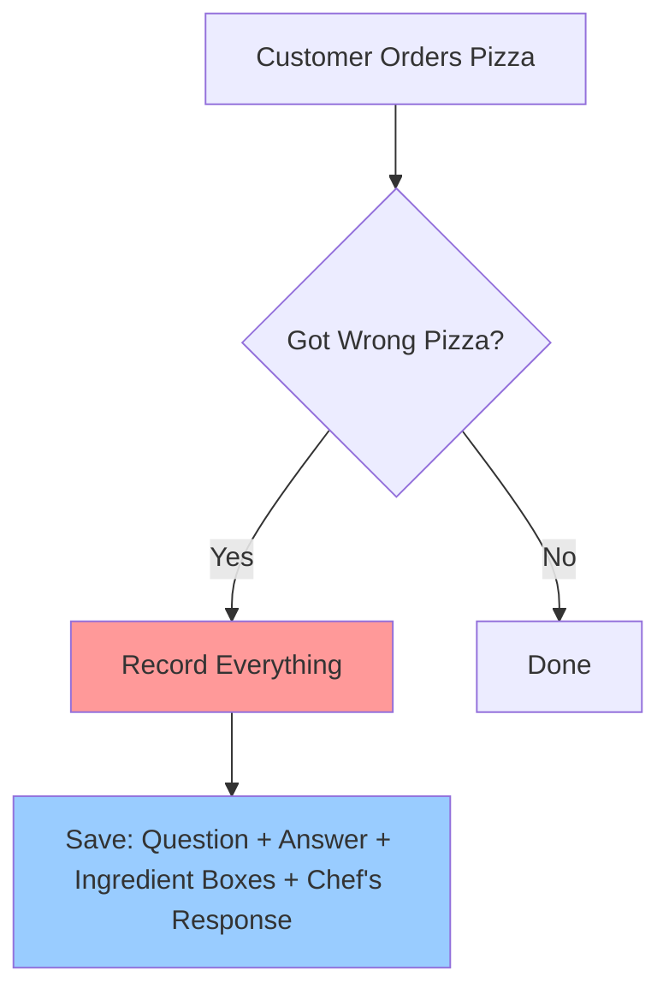
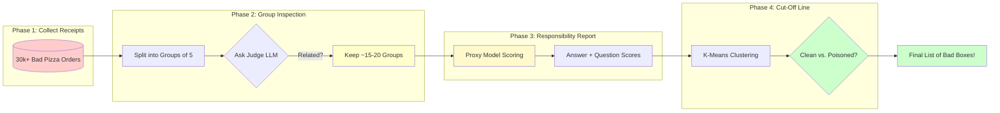

## RAGOrigin ELI5: Who Taught the Lie? 🎯

Let me break this down like you're 5, with some food for thought!

---

## 🍕 The Story: A Pizza Shop Analogy

Imagine a **RAG system is like a pizza delivery service**.

- The **question** = "What toppings on the pepperoni pizza?"
- The **context chunks** = Ingredient boxes in the kitchen
- The **RAG response** = What the chef says you got ("Cheese! Olives!")
- A **poison attack** = Someone hid a bug in 5 ingredient boxes

When the customer complains "I got olives I didn't order!", you want to find which ingredient boxes are the bad ones.

---

## 📦 Phase 1: Feedback Collection (The Receipts)

Think of this as collecting all the **customer complaints**.



**What we have in `k5_m5_e5_gpt-4o-mini.json`:**
- 30,000+ pizza orders that went wrong
- Each order has:
  - The question asked
  - What the chef said (RAG response)
  - All ingredient boxes retrieved (contexts)
  - Which boxes we think might be bad (labels)

**ELI5:** This is just a massive spreadsheet of "Here's every time the RAG gave wrong answers, here were all the contexts it used."

---

## 🔍 Phase 2: Scope Narrowing (Group Inspection)

The kitchen has **30 boxes** of ingredients. Checking each one individually is slow. Instead, we check them in groups of 5 at a time.

```mermaid
flowchart TD
    A[Start with 30 Ingredient Boxes] --> B{Split into Groups of 5}
    B --> C[Group 1: Boxes 1-5]
    B --> D[Group 2: Boxes 6-10]
    B --> E[Group 3: Boxes 11-15]
    
    C --> F{Ask Judge: Is this group relevant?}
    D --> F
    E --> F
    
    F -->|Yes (inconsistent)| G[Mark as "Maybe Bad"]
    F -->|No (consistent)| H["Probably Good, Skip"]
    
    G --> I{Still Need More Evidence?}
    H --> J[Move to Next Group]
    
    I -->|Yes| C
    I -->|Enough Info| K[Finish!]
    
    style C fill:#ffebcc
    style D fill:#ffebcc
    style E fill:#ffebcc
```

**ELI5:** 
- We ask an LLM "If I tell you the chef said 'Cheese!', and here are 5 ingredient boxes, does this group seem related to what caused that answer?"
- If YES → More suspicious! Investigate.
- If NO → Probably fine, check next group.

**Why?** Instead of checking all 30 boxes individually, we only focus on groups that might matter. Like a detective focusing on the neighborhood around the crime scene.

---

## 🎯 Phase 3: Responsibility Measurement (The "Who Did It?" Report)

Now we've narrowed down to ~15-20 suspicious ingredient boxes. We need to ask: **"Which specific box in each group made the answer wrong?"**

We use a **proxy model** (Llama-3.1-8B) like asking a chef's apprentice:

```mermaid
flowchart LR
    subgraph QuestionContextPair["Question + Context = 'The Recipe'" ]
        Q[Customer Question<br/>"What toppings?"]
        X[Ingredient Box #1<br/>"Contains: Cheese"]
        CQ(Question+Context) --> QX(Chef Apprentices Answer)
    end
    
    subgraph JustContext["Just Context = 'The Ingredient'" ]
        Y[Ingredient Box #2<br/>"Contains: Olives"]
        JC(Just Ingredients) --> YJ(Just Chef Apprentice Answer)
    end
    
    CQ --> K1{"Did Apprentice<br/>Generate Good Answer?"}
    YJ --> K2{"Does this box<br/>Explain the Question?"}
    
    K1 -->|High Loss (Bad)| M1["Box 1 contributed<br/>to wrong answer!"]
    K1 -->|Low Loss (Good)| N1["Box 1 probably fine"]
    
    style K1 fill:#ff9999
    style M1 fill:#cc9999
```

**Two flavors of "badness":**

1. **Answer Score**: How much did this box help generate the chef's response? (Like: "Did this ingredient cause the wrong topping?")

2. **Question Score**: Can we even guess the question from just this box? (Like: "Does this ingredient remind us of what we're cooking?")

**ELI5:** 
- We feed each suspicious box into a separate LLM and ask it to recreate the answer or the question.
- If it works easily → Box knew how to make that answer → Possibly contributed.
- If it struggles → Box was less relevant to that specific answer.

---

## 🎚️ Phase 4: Dynamic Thresholding (The "Cut-Off Line")

Now we have scores for all suspicious boxes, like this:

```
Box #3: Score = 0.85  ← Very suspicious!
Box #7: Score = 0.42  ← Medium suspicion
Box #12: Score = 0.31  ← Lower suspicion
Box #28: Score = 0.67  ← High suspicion
```

But how do we decide what "high enough" means? We use **K-means clustering** (like a smart group-maker):

```mermaid
graph TD
    A[All Scores: 0.31, 0.42, 0.67, 0.85] --> B{Cluster into 2 Groups}
    
    B --> C[Group 1 (Low)]
    B --> D[Group 2 (High)]
    
    C --> E{What's their avg?}
    D --> F
    
    E -->|Avg = 0.38| G["These are CLEAN<br/>Ingredient boxes"]
    F -->|Avg = 0.76| H["These are POISONED<br/>Ingredient boxes"]
    
    G --> I{Final Check: Balance?}
    H --> I
    
    I -->|Yes (5&10, 3 each)| J[Done!]
    I -->|No (need more)| A
    
    style C fill:#ccffcc
    style D fill:#ffffcc
    style I fill:#ffff99
```

**ELI5:** 
- The clustering algorithm finds a natural break point in the scores.
- If 5 boxes scored above that line → They're likely poisoned.
- If 3 boxes scored below → They're clean.

This happens **per question-answer pair**, so the "cut-off" is different for each pizza order!

---

## 🔄 Putting It All Together: The Detective's Workflow



---

## 📊 Output Files (What You Get at the End)

| File | What It Is | ELI5 Analogy |
|------|-------------|--------------|
| `scores_iter_result.json` | All the proxy model scores | "The full detective report: every suspicious box's score" |
| `metric_result.json` | Accuracy, FPR, FNR stats | "How well did we catch the bugs? (e.g., 85% DACC = great!)" |
| `context_result.json` | Which boxes are clean vs. poisoned | "The final list: Box #3, #7, #12 are bad, rest are good" |

---

## 🧠 Mental Model Summary

| Phase | What We're Doing | Analogy |
|-------|------------------|---------|
| **1. Collect Receipts** | Save all the complaints | "Here's every time pizza went wrong" |
| **2. Group Inspection** | Check boxes in groups of 5 | "Don't look at every box—focus on suspicious areas first!" |
| **3. Responsibility Report** | Score how much each box helped the bad answer | "Which boxes made the chef's mistake worse?" |
| **4. Cut-Off Line** | Use K-means to split clean vs. poisoned | "Find the natural break point between good and bad" |

---

## 🤔 Why So Complicated?

- **30,000+ pizza orders** = need automation! (Async batches)
- **30 boxes per order** = too many to check individually → Group them!
- **Different pizzas have different answers** = threshold needs to be specific per order → Dynamic K-means!

---

## 🚀 Quick Diagram: The "Score & Decide" Pipeline

```mermaid
sequenceDiagram
    participant Data[30k+ Orders]
    participant Narrow[Scope Narrowing]
    participant Proxy[Llama Model]
    participant Cluster[K-Means]
    participant Judge[Judge LLM]
    
    Data->|Load| Data
    Data->|Pass to| Narrow
    Narrow->|Ask about 5-box Groups| Judge
    Judge->|Scores| Judge
    Narrow->|Keep ~15-20 Groups| Narrow
    
    narrowLoop[For Each Suspicious Box]
        Proxy->|Score It!| Proxy
    end
    
    Proxy->|All Scores| Cluster
    Cluster->|Find Cut-Off| Cluster
    Cluster->|Final Split| Judge
    
    Judge->|Clean/Toxic?| Judge
    Judge->|Acc/FPR/FNR Stats| Judge
```

---

## 💡 TL;DR

**Phase 1–4 =** 
1. **Collect** all the bad answers + their ingredient boxes.
2. **Narrow down** to which groups of boxes might be relevant.
3. **Score each box** with a proxy model to see how suspicious it is.
4. **Find the cut-off** for each order using smart clustering.

**Result:** A final list saying, "For this question-answer pair, these 5 specific ingredient boxes are likely poisoned!"

---

Still stumped? Tell me which part feels fuzzy and we'll dive deeper! 🎯
6:32 PM

